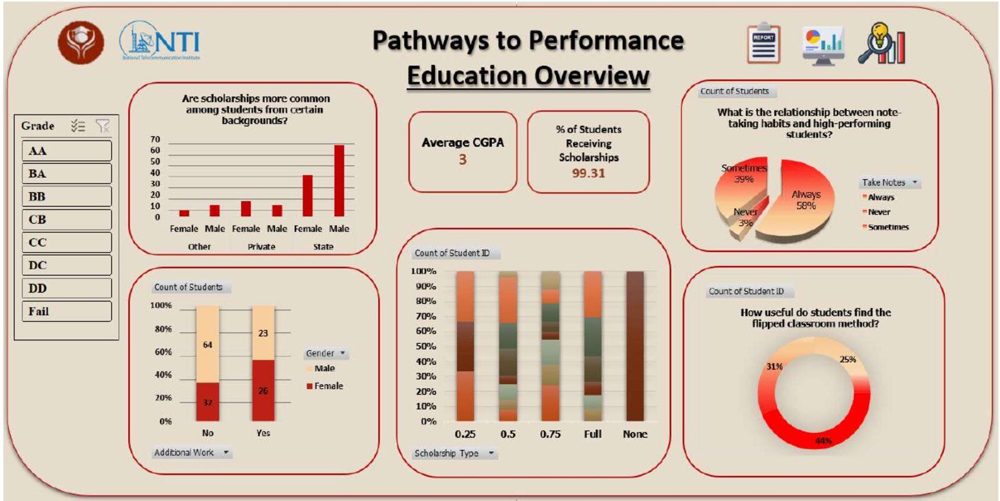
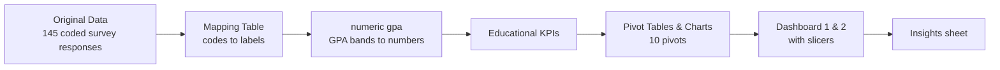
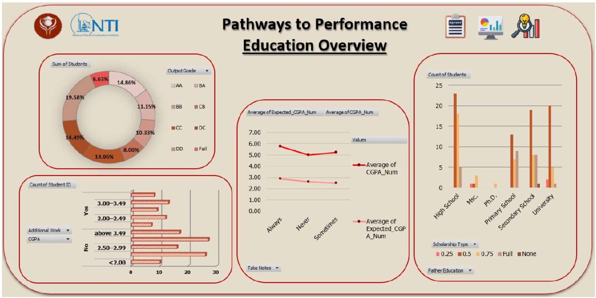

# Pathways to Performance: Education Analytics Dashboard (Excel)

An Excel analysis of a 145-student survey that explores how study habits, scholarships, work and family background relate to academic performance, delivered as two interactive dashboards with written insights.


> **Team project** completed during the NTI Data Analysis training program. Original repository by Farah Balba'a; this is my fork.



## Problem

Universities want to know which factors are linked to student success. Survey data is coded as numbers (1 to 30 per question), which makes it hard to read. The goal was to turn it into clear indicators and visuals that answer specific questions.

## Questions explored

- Are scholarships more common among students from certain backgrounds?
- Is there a relationship between note-taking habits and performance?
- How useful do students find the flipped classroom method?
- How does having a job relate to GPA?
- Is a father's education level linked to scholarship type?
- How do expected and actual CGPA compare?

## Workflow



| Sheet | Purpose |
|---|---|
| Original Data | Raw survey responses (student ID, 30 coded answers, course, grade) |
| Mapping_Table | Translates each code into a readable label |
| numeric gpa | Converts GPA bands into numeric values for averaging |
| Educationl_KPIs | KPI calculations such as average CGPA and scholarship rate |
| Pivot Tables & Charts | The 10 pivot tables behind the dashboards |
| Dahboard1, Dahboard2 | Interactive dashboards filtered by grade, gender, work status and scholarship type |
| insights | Written findings |

## Key insights

Taken from the workbook's own insights sheet:

- Scholarships are more common among students from **state** backgrounds.
- **65%** of high-performing students take notes.
- Most students, particularly males, **do not work** while studying, and most high GPAs belong to students without jobs.
- Only **31%** find the flipped classroom useful; 44% do not and 25% say it does not apply.
- Most students fall in the middle to lower grade range (CC 14.96%, DC 14.49%, DD 19.58%); 6.63% failed.
- There is **no clear relationship** between a father's education and receiving a scholarship; 0.5 scholarships are the most common across all groups.
- Students tend to **overestimate** their expected CGPA, and the gap is largest among those who always take notes.

<details>
<summary>Dashboard page 2</summary>



</details>

## Tools

- **Microsoft Excel**: data mapping, calculated columns, KPIs, pivot tables, pivot charts, slicers

## How to open

Download `Education_Sheet.xlsx` and open it in Excel. A static export of both dashboards is in [`Dashboards.pdf`](Dashboards.pdf).

## Repository contents

```
Education_Sheet.xlsx   Workbook with data, KPIs, pivots, dashboards and insights
Dashboards.pdf         PDF export of the two dashboards
images/                Screenshots used in this README
```

## Team

- Farah Balba'a and team (original repository)
- [Lina Amer](https://github.com/LinaAmer12)

---

📫 Lina Amer · [LinkedIn](https://www.linkedin.com/in/linaamer1) · [linaamer1312@gmail.com](mailto:linaamer1312@gmail.com)
